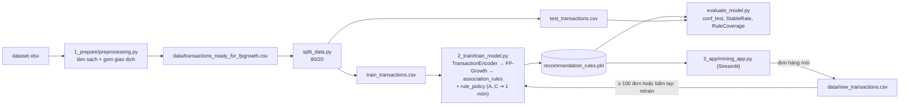

# fp-growth-recommender — Gợi ý sản phẩm bằng luật kết hợp FP-Growth

> **EN:** Market-basket product recommender: mines association rules from retail invoices with FP-Growth (mlxtend), evaluates rule stability on a held-out split, and serves a Streamlit storefront + admin dashboard with continuous retraining.

## Mô tả

Hệ thống khai phá luật kết hợp từ dữ liệu hoá đơn bán lẻ (`dataset.xlsx`, các cột `InvoiceNo`, `Description`, `Quantity`, `UnitPrice`, …) và dùng các luật đó để gợi ý sản phẩm khi người dùng thêm hàng vào giỏ.

Những gì có trong code:
- **Tiền xử lý** (`1_prepare/preprocessing.py`): bỏ dòng thiếu `InvoiceNo`/`Description`, bỏ hoá đơn huỷ (mã bắt đầu bằng `C`), bỏ số lượng/giá ≤ 0, bỏ trùng; chỉ giữ hoá đơn có 2–50 mặt hàng; gom thành danh sách giao dịch.
- **Chia dữ liệu** (`split_data.py`): ngẫu nhiên 80% train / 20% test (`random_state=42`).
- **Huấn luyện** (`2_train/train_model.py`): mã hoá 0-1 bằng `TransactionEncoder`, chạy `fpgrowth` (`min_support = 0.01`), sinh luật bằng `association_rules` (lift ≥ 1.2), lọc theo quy ước gợi ý **A ⇒ B, A,B ⇒ C, A,B,C ⇒ D** (vế trái 1–3 món, vế phải đúng 1 món — `rule_policy.py`), lưu ra `recommendation_rules.pkl`. `find_best_params.py` dò `min_support`.
- **Đánh giá** (`2_train/evaluate_model.py`): tính lại support/confidence của từng luật trên tập test, báo cáo StableRate, AvgConfDrop và RuleCoverage trên train/test. Kết quả hiện tại (`rules_evaluation_summary.txt`, `conf_generalization_summary.txt`): **383 luật**, lift trung bình 11.78, MAE |conf_train − conf_test| = 0.039, tương quan Pearson 0.958.
- **Ứng dụng Streamlit** (`3_app/mining_app.py`):
  - *Cửa hàng (User):* chọn sản phẩm vào giỏ, hiển thị gợi ý từ các luật có vế trái nằm trong giỏ; thanh toán lưu đơn (≥ 2 món) vào `data/new_transactions.csv`.
  - *Bảng điều khiển (Admin):* 3 tab — Tổng quan kinh doanh, Quản lý luật gợi ý, Học liên tục.
  - *Học liên tục:* gộp giao dịch mới vào tập train và train lại FP-Growth; tự động khi đủ **100** giao dịch mới hoặc bấm tay.
- **Tiện ích** (`utils/`): xuất luật ra CSV, thống kê độ dài vế trái, vẽ phân bố luật và biểu đồ conf_train vs conf_test (ảnh trong `images/`).

## Kiến trúc



## Công nghệ

- Python 3
- pandas, mlxtend (`fpgrowth`, `association_rules`, `TransactionEncoder`), joblib
- Streamlit (web app), matplotlib (biểu đồ)
- openpyxl (pandas cần để đọc `.xlsx`)

## Cách chạy

Dự án không dùng secret nên không có `.env`.

```bash
pip install pandas mlxtend joblib streamlit matplotlib openpyxl

python 1_prepare/preprocessing.py        # dataset.xlsx → data/transactions_ready_for_fpgrowth.csv
python 1_prepare/split_data.py           # chia train/test
python 2_train/train_model.py            # train → recommendation_rules.pkl
python 2_train/evaluate_model.py         # đánh giá trên tập test
streamlit run 3_app/mining_app.py        # mở web app
```

Repo đã có sẵn `recommendation_rules.pkl` và các CSV trong `data/`, nên có thể chạy thẳng bước cuối. Mỗi script tự chuyển thư mục làm việc về gốc project, nên chạy từ đâu cũng được.

## Cấu trúc thư mục

```
fp-growth-recommender/
├── 1_prepare/
│   ├── preprocessing.py           # làm sạch dataset.xlsx
│   └── split_data.py              # chia train/test 80/20
├── 2_train/
│   ├── train_model.py             # FP-Growth → recommendation_rules.pkl
│   ├── find_best_params.py        # dò min_support
│   └── evaluate_model.py          # đánh giá độ ổn định luật trên test
├── 3_app/
│   ├── mining_app.py              # Streamlit: cửa hàng + admin + retrain
│   ├── admin_dashboard.py         # xuất biểu đồ EDA + doanh thu
│   ├── group_transactions_demo.py # demo bước gom giao dịch
│   └── binary_encoding_demo.py    # demo bước mã hoá 0-1
├── utils/                         # pkl → csv, thống kê & biểu đồ luật
├── rule_policy.py                 # quy ước dạng luật dùng chung
├── dataset.xlsx                   # dữ liệu gốc
├── recommendation_rules.pkl       # tập luật đã train
├── data/                          # CSV trung gian
└── images/                        # biểu đồ PNG
```
